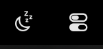
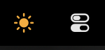

<div align="center">


# StayOn

**One click. Close the lid. Your Mac keeps working.**

A tiny menu bar app that keeps your MacBook awake with the lid closed.<br>
No timers, no presets, no account, and nothing to configure.

[](https://github.com/yyswn/StayOn/actions/workflows/ci.yml)
[](https://github.com/yyswn/StayOn/releases)


[](LICENSE)

[**Download**](https://github.com/yyswn/StayOn/releases/latest) · [How it works](#how-it-works) · [Safety](#safety) · [Build from source](#build-from-source)

| Off | On |
| :---: | :---: |
|  |  |

</div>

> [!NOTE]
> **Early release.** All automated logic tests pass, but closing the lid on real hardware has not been fully verified yet. Keep an eye on it the first few times, and please [report anything odd](https://github.com/yyswn/StayOn/issues).

## Why StayOn?

macOS sleeps when you close the lid, which stops your downloads, builds, servers and remote sessions. StayOn does one job: it turns that off until you turn it back on.

- **One click.** Click the icon to turn it on, and click again to turn it off.
- **No timer.** It stays on until you say otherwise.
- **Works with the lid closed.** The screen turns off to save power while everything else keeps running.
- **Hard to get wrong.** It warns you before actions that would sleep the Mac and cut remote connections, and it steps in on low battery or critical heat.
- **Small and readable.** One Swift file with no dependencies, no network access and no analytics.

## Install

1. Download `StayOn.dmg` from the [latest release](https://github.com/yyswn/StayOn/releases/latest).
2. Open it and drag **StayOn** to **Applications**.
3. Open StayOn. A moon appears in your menu bar.

**macOS will warn you on first launch.** StayOn isn't notarized by Apple yet. To open it, go to **System Settings → Privacy & Security** and choose **Open Anyway**.

**Can't see the icon?** Crowded menu bars hide icons. Look behind the `«` overflow control, or check the Menu Bar section of System Settings.

## Usage

| Action | Result |
| --- | --- |
| **Click** the icon | Turn on or off |
| **Right-click** the icon | Status, Open at Login, Quit |
| **Command-drag** the icon | Move it along the menu bar |

The first time you turn it on, StayOn asks for your password once so it can change the sleep setting ([details](#permissions)).

We recommend turning on **Open at Login**, so StayOn can restore normal sleep after a restart.

## How it works

StayOn is a friendly switch for a setting built into macOS:

```sh
sudo pmset -a disablesleep 1   # on
sudo pmset -a disablesleep 0   # off
```

The icon always shows the real system setting, so it can't drift out of sync with your Mac.

| Event | What StayOn does |
| --- | --- |
| Lid closes while on | Turns the screen off and keeps the Mac running |
| You turn it off with the lid closed | Asks first, because the Mac will sleep right away |
| You quit | Restores normal sleep if StayOn turned it off |
| StayOn crashes | Keeps the session when reopened |
| Mac restarts | Goes back to off the next time StayOn opens |
| Another app changes the setting | Follows the change, and never undoes a hold it didn't create |

## Safety

Even with no timer, StayOn turns itself off when:

- **The battery reaches 10%** while not charging. If you turn it on below 10%, it respects that until the battery next drops back to the limit.
- **macOS reports a critical temperature.**

> [!WARNING]
> Don't carry your Mac in a bag with StayOn on. A closed laptop that's still running has less airflow, can get hot, and keeps using battery. Turn it off before you pack up.

Without **Open at Login**, sleep can stay disabled after a restart until you next open StayOn.

### Permissions

Changing this setting requires admin rights. On first use, StayOn asks for your password through the standard macOS dialog and adds `/etc/sudoers.d/stayon`, which allows only these two commands without a password:

```
/usr/bin/pmset -a disablesleep 0
/usr/bin/pmset -a disablesleep 1
```

This means any program running under your account could also turn sleep on or off. It grants no other admin access.

## Limitations

- **Battery life:** a running Mac with its lid closed uses far more power than a sleeping one, and StayOn does nothing else to reduce that.
- **Other sleep tools:** if another app also controls this setting, whichever acts last wins. Run only one at a time.
- **Not notarized:** macOS shows the warning described under [Install](#install).

## Build from source

Requires macOS 13 or later and the Xcode Command Line Tools (`xcode-select --install`).

```sh
git clone https://github.com/yyswn/StayOn.git
cd StayOn
bash build-dmg.sh     # creates StayOn.dmg for Apple silicon and Intel
```

### Tests

```sh
bash test.sh
```

The tests drive a special build of the app through its on/off scenarios, including lid changes, low battery, crashes, restarts and a cancelled password prompt. That build uses a fake `pmset`, lid and battery, so **your real sleep setting is never touched**. The test code is compiled out of the released app.

### Project layout

| File | Purpose |
| --- | --- |
| `StayOn.swift` | The whole app |
| `test.sh` | End-to-end logic tests |
| `build-dmg.sh` | Builds the app and DMG |
| `make-icon.swift` | Draws the app icon |
| `uninstall.sh` | Removes StayOn |

## Uninstall

Turn off **Open at Login**, then run this from the project folder:

```sh
bash uninstall.sh
```

This quits StayOn, restores normal sleep if StayOn turned it off, and removes the app, its data and its sudo rule. If you downloaded only the DMG, get `uninstall.sh` from this repo.

> [!CAUTION]
> If the lid is closed and StayOn is keeping the Mac awake, uninstalling puts it to sleep straight away.

## Contributing

Bug reports and pull requests are welcome. StayOn deliberately stays small, so please [open an issue](https://github.com/yyswn/StayOn/issues) to discuss new features first. Run `bash test.sh` before submitting.

## Credits

Inspired by Insomnia by Krish Garg, a much fuller lid-closed session manager. StayOn is an independent, from-scratch implementation of the simplest version of the idea.

## License

[MIT](LICENSE) © 2026 Fazlay Rabby Shawon
